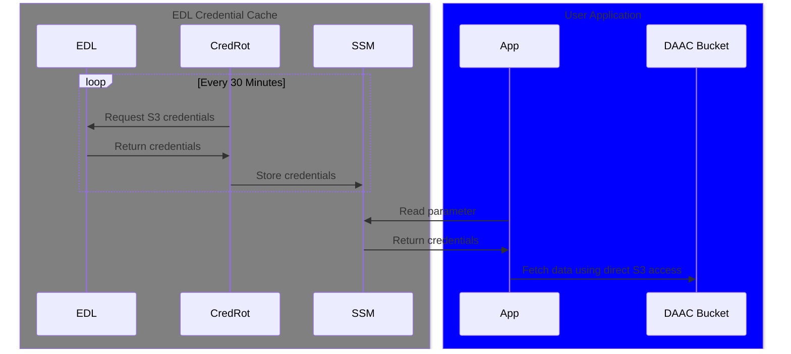

# edl-credential-rotation

AWS CDK tooling for automatically refreshing Earthdata Login temporary S3 credentials
([DAAC /s3credentials](https://nasa.github.io/cumulus-distribution-api/#temporary-s3-credentials)).

Two approaches are provided:

1. **Standalone CDK app** (`cdk/app.py`) — deploys a scheduler that writes fresh credentials
   directly into a target Lambda's environment variables.
2. **`EarthdataCredentialCache` construct** — a reusable CDK construct that caches credentials
   in SSM Parameter Store so multiple services can share them without each independently calling
   the DAAC credentials endpoint.

## Usage

### Standalone CDK app

The standalone app (`cdk/app.py`) is a self-contained deployment that rotates credentials into
a target Lambda's environment variables every 30 minutes.

#### Environment settings

```
$ export STACKNAME=<Name of your stack>
$ export PROJECT=<The project name for resource cost tracking>
$ export LAMBDA=<The ARN of the Lambda that will receive new S3 credentials>
$ export USERNAME=<A valid Earthdata Login username>
$ export PASSWORD=<A valid Earthdata Login password>
```

#### CDK commands

```bash
# Preview the CloudFormation template
$ cdk synth

# Show a diff against the current deployment
$ cdk diff

# Deploy
$ cdk deploy
```

### EarthdataCredentialCache construct

The `EarthdataCredentialCache` construct is a reusable CDK construct for inclusion in your
own CDK application. It addresses the thundering-herd problem that arises when many services
independently call the DAAC credentials endpoint: instead, a single Lambda refreshes the
credentials on a schedule and stores them in SSM Parameter Store for any service to read.

See `examples/app.py` for a minimal CDK application using the construct.

```python
from edl_credential_rotation import EarthdataCredentialCache

class MyStack(Stack):
    def __init__(self, scope, id, **kwargs):
        super().__init__(scope, id, **kwargs)
        self.edl_cache = EarthdataCredentialCache(self, "EdlCache")
        # Allow a consumer to read the cached S3 credentials
        self.edl_cache.grant_read(my_function)
```

CloudFormation cannot create `SecureString` parameters, so the construct references
parameters by name rather than creating them (prefix defaults to `/<stack name>/<construct id>`,
configurable via `parameter_prefix`):

- `<prefix>/edl-user-account-credentials` - **create this manually** before the rotator runs:

  ```bash
  aws ssm put-parameter \
    --name "/<stack name>/<construct id>/edl-user-account-credentials" \
    --type SecureString \
    --value '{"USERNAME": "<username>", "PASSWORD": "<password>"}'
  ```

- `<prefix>/edl-s3-credentials` - written by the rotator Lambda as a `SecureString` containing
  JSON with `ACCESS_KEY_ID`, `SECRET_ACCESS_KEY`, `SESSION_TOKEN`, and `EXPIRATION` keys. It is
  created on the first run and is **not** deleted when the stack is destroyed.

Both parameters are encrypted with the AWS managed `aws/ssm` KMS key.

#### High throughput

By default Parameter Store throughput for `GetParameter` is limited to 40 TPS per account and
region, shared across all parameters. If many consumers read the credentials concurrently
(e.g., a large burst of Batch jobs or Lambda cold starts), you can enable high throughput to
raise the limit (up to 10,000 TPS). This is an **account/region wide** setting that bills every
Parameter Store API call ($0.05 per 10,000 calls), so this construct does not manage it. Caching
the credentials in consumers (see below) is usually enough to stay within the default limit.
To enable it manually:

```bash
aws ssm update-service-setting \
  --setting-id "arn:aws:ssm:<region>:<account id>:servicesetting/ssm/parameter-store/high-throughput-enabled" \
  --setting-value true
```

See the [AWS documentation](https://docs.aws.amazon.com/systems-manager/latest/userguide/parameter-store-throughput.html)
for details.

The system deployed by this construct:



Once credentials are stored in Parameter Store they can be retrieved in several ways (remember
to request decryption, e.g. `WithDecryption=True`). Common patterns:

- **Lambda** — retrieve the parameter during [static initialization](https://docs.aws.amazon.com/lambda/latest/dg/lambda-runtime-environment.html#static-initialization)
  so it is fetched once per container, not per invocation. AWS also provides a
  [Parameters and Secrets extension layer](https://docs.aws.amazon.com/systems-manager/latest/userguide/ps-integration-lambda-extensions.html)
  that handles caching automatically.
- **AWS Batch / ECS** — reference the parameter as a secret in the job/task definition; it is
  injected as an environment variable.
- **Long-lived processes** — use a singleton that fetches, caches, and refreshes the parameter before expiry.

## Development

### Requirements

- Python>=3.10
- Docker
- [uv](https://docs.astral.sh/uv/getting-started/installation/)
- aws-cli
- An IAM role with sufficient permissions for creating, destroying and modifying the relevant stack resources.

To begin, install developer and application dependencies using `uv`,

```
$ uv sync --all-groups
```

Then run the following to install the project's pre-commit hooks

```
$ pre-commit install
```

## Linting, formatting, and type checks

This project uses `ruff` for lint/formatting and `mypy` for type checks,

```
$ scripts/format
$ scripts/lint
$ scripts/typecheck
```

## Tests

To run unit test for the credential rotation Lambda function,

```
scripts/test
```
